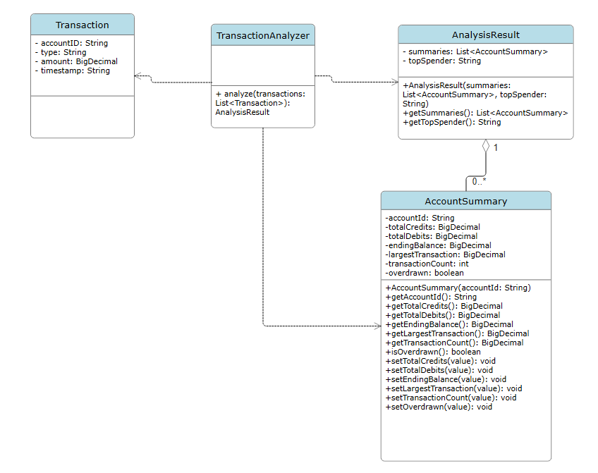

# Take-Home Coding Exercise: Transaction Analyzer
## Objective
Build a small program that processes a list of financial transactions and produces account-level summaries.

## How to run the solution
Requires JDK 21 or newer and Maven. From the project root, run
```
mvn clean test
java -cp target/classes com.mukulsauhta.transactionanalyzer.Main
```
The first command compiles the project and runs the unit tests. The second runs a built-in example.

Other transaction lists can be passed to TransactionAnalyzer.analyze(List<Transaction>).


## Assumptions I made
- There is no need to process the transactions chronologically, since input may not be sorted by timestamp and the transactions regardless of time will total to the same amount. Unless the program instructions explicitly asked me to check the balance at a certain time, it would be unnecessary.

- The input list must be non-null. Null transaction entries, null amounts, and null or blank account IDs are ignored.

- Transaction types are case-sensitive: "credit" and "debit".

- Only accounts with valid transactions appear. Empty or entirely invalid input returns empty summaries and a null topSpender.

## Design Choices
### Preliminary UML Diagram (before coding anything)

- One of the first things I considered when understanding the transactions that this program would accept was creating an abstract class for Transactions, so it could have two child classes:
  - Debit subclass
  - Credit subclass
- I ended up going against the above decision; it would be redundant because we're explicitly given the type of transaction in valid input, and they would contain the exact same methods/fields, which don't necessarily behave differently (they both just apply the transaction to the balance.
- For the UML Diagram, some objects are left with no methods or attributes; this is because as I was deciding how to separate the classes and document their methods, I wasn't sure on how some things would turn out.
  - I initially wanted to utilize a stateful implementation where TransactionAnalyzer would store a list of transactions, but the problem is there is more simplicity in a per request solution as opposed to storing everything.
- BigDecimal supports exact decimal calculations for monetary amounts.
- TreeMap maintains account ID ordering, with logarithmic lookup and update costs.
- Ending balances are calculated from the completed credit and debit totals. Timestamps are retained but neither validated nor used in calculations.
- Tests cover calculations, ordering, invalid transactions, empty results, spending ties, and overdraft boundaries.